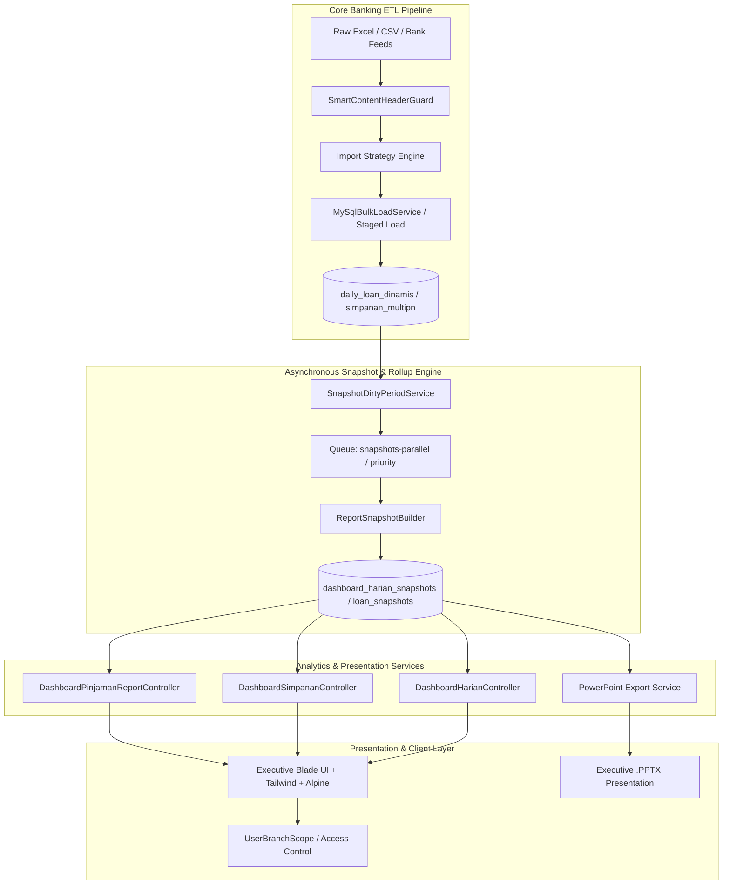

# Project ABAH (Dashboard A-Six)

[](https://laravel.com)
[](https://php.net)
[](https://www.mysql.com)
[](https://vitejs.dev)
[](https://tailwindcss.com)
[](LICENSE)

**Project ABAH** (commercially branded as **Dashboard A-Six**) is an enterprise-grade Banking Intelligence, Portfolio Management, and Financial Analytics Platform. Designed specifically for regional branch banking networks (Regional Office / Kanwil, Branch Office / Kanca, Sub-Branch, and Micro Units), it centralizes multi-million row core banking transaction data, provides real-time portfolio monitoring, automates risk tracking, and generates executive PowerPoint presentation decks.

---

## Table of Contents

- [Overview](#overview)
- [Key Modules & Capabilities](#key-modules--capabilities)
  - [1. Loan Portfolio Intelligence (`dashboard-pinjaman`)](#1-loan-portfolio-intelligence-dashboard-pinjaman)
  - [2. Deposit & Savings Analytics (`dashboard-simpanan`)](#2-deposit--savings-analytics-dashboard-simpanan)
  - [3. Daily Executive Dashboard (`dashboard-harian`)](#3-daily-executive-dashboard-dashboard-harian)
  - [4. High-Throughput Core Banking ETL Engine (`import`)](#4-high-throughput-core-banking-etl-engine-import)
  - [5. Automated PowerPoint Deck Generator (`presentation`)](#5-automated-powerpoint-deck-generator-presentation)
  - [6. Weekly Prognosa & Target Forecasting (`prognosa`)](#6-weekly-prognosa--target-forecasting-prognosa)
  - [7. Multi-Tier Work Unit Scoping (`access-control`)](#7-multi-tier-work-unit-scoping-access-control)
  - [8. DriveASIX Document Collaboration Engine](#8-driveasix-document-collaboration-engine)
  - [9. Repository Knowledge Graph](#9-repository-knowledge-graph)
- [System Architecture & Invariants](#system-architecture--invariants)
- [Technology Stack](#technology-stack)
- [Prerequisites](#prerequisites)
- [Installation & Setup](#installation--setup)
- [Queue & Background Worker Architecture](#queue--background-worker-architecture)
- [Repository Knowledge Graph CLI](#repository-knowledge-graph-cli)
- [Database Performance & Optimization Rules](#database-performance--optimization-rules)
- [Testing & Quality Assurance](#testing--quality-assurance)
- [License](#license)

---

## Overview

Regional banking operations handle massive daily data streams spanning credit portfolios, retail savings, merchant ecosystems, digital banking adoptions, and non-performing asset recoveries. 

Project ABAH eliminates operational data fragmentation by providing:
- **Instant Decision Support**: High-velocity visual analytics for Outstanding Loans (OS), Total Third-Party Funds (DPK), and Loan-to-Deposit Ratio (LDR).
- **Proactive Risk Management**: Multi-stage loan migration matrices, Under-Grading / NPL degradation monitoring, Day-Past-Due (DPD) mismatch audits, and recovery intelligence for written-off loans (PH / LW325).
- **Automated Pipeline Materialization**: Asynchronous ingestion of giant core banking tabular exports (millions of rows) with automated schema-safe mapping and snapshot rebuilds.
- **Hierarchical Governance**: Strict branch isolation allowing branch managers, relationship managers, and regional executives to see only their authorized portfolio scope.

---

## Key Modules & Capabilities

### 1. Loan Portfolio Intelligence (`dashboard-pinjaman`)
- **Daily Loan Dinamis**: Manages and queries dynamic daily loan portfolios (~16M+ records) at the grain of `periode` + `nomor_rekening1`.
- **Collectibility Migration Matrix (Matrix Pergeseran Kolek)**: Tracks month-to-month and period-to-period credit quality transitions (Kolek 1 to 5). Dynamic nominative drilldowns provide both previous comparison balance (`pivot_previous_balance`) and current active balance (`baki_debet1`).
- **Risk & Quality Analytics**:
  - *Analisa UG-NPL*: Early warning tracking for downgrade risk and non-performing loans.
  - *Kolek vs DPD Mismatch*: Identifies discrepancies between recorded collectibility and actual days past due.
  - *Tunggakan Kecil & Realisasi 6-Bulan*: Highlights minor arrears and fresh disbursements entering delinquency.
  - *Data PH (Recovery Intelligence)*: Monitors recovery cash flow, outstanding balances, and liquidation of written-off portfolios (`lw325_ph`).
- **RM Performance Analytics**: Evaluates Relationship Managers (Micro & SME) across disbursement targets, portfolio quality, and pipeline productivity.

### 2. Deposit & Savings Analytics (`dashboard-simpanan`)
- **Core Deposit Analytics**: Granular monitoring of Savings (Tabungan), Current Accounts (Giro), and Time Deposits (Deposito) powered by `simpanan_multipn` and `ssa_simpanan`.
- **CASA Ratio Optimization**: Continuous tracking of low-cost funds (Current Account and Savings Account ratio) versus expensive time deposits.
- **Digital Adoption & Merchant Growth**: Integrates data from electronic channels and merchant payment rails, including QRIS, EDC terminals, Mobile Banking (BRIMo), Agent Banking (BRILink), and Corporate Cash Management (Qlola).

### 3. Daily Executive Dashboard (`dashboard-harian`)
- **Consolidated Balance Sheet Indicators**: Real-time aggregation of loans, deposits, gap balances, and coverage ratios.
- **RKA Performance Alignment**: Compares actual branch performance against institutional budget targets (*Rencana Kerja dan Anggaran / RKA*).
- **Snapshot Materialization**: Optimized via `dashboard_harian_snapshots` for sub-second executive landing page response times.

### 4. High-Throughput Core Banking ETL Engine (`import`)
- **Dual-Engine Ingestion**: Supports direct SQL bulk loading and staged CSV high-speed pipelines for giant bank data exports.
- **Smart Content & Header Guard (`SmartContentHeaderGuardService`)**: Automatically maps diverse core banking headers (e.g., `CBAL_Base`, `ORGAMT_Base`, `KOLEK_*`, `PN_REFERAL`) to normalized database columns (`balance_dalam_idr`, `plafon_dalam_idr`, etc.).
- **Automated Previews & Safe Transactions**: Interactive upload preview with schema validation before materialization into production tables.

### 5. Automated PowerPoint Deck Generator (`presentation`)
- **Executive Reporting Decks**: One-click generation of fully styled, slide-ready Microsoft PowerPoint (`.pptx`) decks.
- **Native Charts & Tables**: Generates native presentation charts (micro trends, liquidity, deposit distribution, and branch rankings) directly from live database snapshots.

### 6. Weekly Prognosa & Target Forecasting (`prognosa`)
- **Cutoff Forecasting**: Tracks progressive weekly targets across weekly checkpoints (Week 1 through Week 5).
- **Pacing Projections**: Calculates required run rates and month-end landing projections.

### 7. Multi-Tier Work Unit Scoping (`access-control`)
- **Granular Scoping**: Built-in enforcement across Kanwil (Regional), Kanca (Main Branch), and Unit Kerja (Sub-branches).
- **Session Protection**: Automatic session lock release (`releaseSessionLockIfNeeded()`) preventing heavy analytical AJAX queries from blocking subsequent user navigation.

### 8. DriveASIX Document Collaboration Engine
- **Internal Document Hub**: Central repository for regional banking circulars, target decks, and operational guidelines.
- **ONLYOFFICE Document Server Integration**: Enables collaborative web-based editing for Word documents, spreadsheets, and presentations with JWT-secured access controls.

### 9. Repository Knowledge Graph
- **Built-in Architectural Memory**: Deterministic static knowledge graph mapping files, classes, methods, database tables, queue pipelines, and routes.
- **Assistant-Friendly CLI**: Enables AI coding agents and human maintainers to navigate symbols and architectural boundaries efficiently via `php artisan knowledge:graph`.

---

## System Architecture & Invariants



### Core Invariants:
1. **SARGable Query Execution**: Always filter on indexed period keys (`WHERE periode = ?` / `WHERE snapshot_period = ?`) to avoid full table scans across millions of rows.
2. **Snapshot Materialization**: Heavy cross-table joins are pre-aggregated asynchronously into dedicated snapshot tables; the UI reads directly from snapshots.
3. **No Redundant MySQL Indexes**: Avoid left-prefix redundant indexes on multi-million row tables such as `simpanan_multipn` and `daily_loan_dinamis`.

---

## Technology Stack

- **Backend Framework**: [Laravel 12.x](https://laravel.com) (PHP 8.2+)
- **Database Engine**: [MySQL 8.0+](https://www.mysql.com) (InnoDB with custom indexing and partitioning strategies)
- **Frontend & UI**:
  - [Blade Templates](https://laravel.com/docs/blade)
  - [Tailwind CSS 3.x](https://tailwindcss.com) + Tailwind Forms
  - [Alpine.js 3.x](https://alpinejs.dev)
  - [Chart.js](https://www.chartjs.org) & [Three.js](https://threejs.org)
  - [Vite 7.x](https://vitejs.dev)
- **Excel & Presentation Processing**:
  - [PhpSpreadsheet 5.x](https://github.com/PHPOffice/PhpSpreadsheet)
  - [PHPPresentation](https://github.com/PHPOffice/PHPPresentation)
- **Queue & Scheduling**: Laravel Queue Worker (Database/Redis driver with multi-priority workers)
- **Testing**: [Pest PHP](https://pestphp.com) & [PHPUnit](https://phpunit.de)

---

## Prerequisites

Ensure the following tools are installed in your environment:
- **PHP**: `^8.2` with extensions enabled: `pdo_mysql`, `mbstring`, `xml`, `zip`, `gd`, `bcmath`, `curl`.
- **Composer**: `^2.4`
- **Node.js**: `^18.x` or `^20.x` & **npm**: `^9.x`
- **MySQL**: `^8.0`
- **PowerShell**: `5.1+` (for Windows / XAMPP environments)

---

## Installation & Setup

### 1. Clone Repository
```bash
git clone https://github.com/RizalloN/project-abah.git
cd project-abah
```

### 2. Install Dependencies
```bash
# Install PHP Composer dependencies
composer install

# Install Frontend NPM packages
npm install
```

### 3. Environment Configuration
```bash
# Copy example environment configuration
copy .env.example .env

# Generate unique application key
php artisan key:generate
```

Configure your database connection in `.env`:
```env
DB_CONNECTION=mysql
DB_HOST=127.0.0.1
DB_PORT=3306
DB_DATABASE=project_abah
DB_USERNAME=root
DB_PASSWORD=
```

### 4. Run Migrations & Seeders
```bash
php artisan migrate
```

### 5. Build Frontend Assets
```bash
# Development mode
npm run dev

# Or build for production
npm run build
```

---

## Queue & Background Worker Architecture

Project ABAH processes large banking imports and analytical snapshot materializations asynchronously across multiple dedicated queues:

| Queue Name | Purpose | Recommended Worker Flags |
| :--- | :--- | :--- |
| `imports-high` | High-priority interactive file uploads and preview validation | `--tries=1 --timeout=0 --sleep=1` |
| `imports-daily-loan` | Heavy daily loan table materialization (~16M+ rows) | `--tries=1 --timeout=0 --sleep=1` |
| `snapshots-priority` | Critical landing page snapshot recalculations | `--tries=1 --timeout=0 --sleep=1` |
| `snapshots-parallel` | Background analytical rollups and matrix rebuilding | `--tries=1 --timeout=0 --sleep=1` |
| `shadow-backfill` | Shadow table data sync and rule evaluation | `--tries=1 --timeout=0 --sleep=1` |
| `default`, `reports-low` | Standard background tasks and notifications | `--tries=1 --timeout=0 --sleep=1` |

### Starting Background Workers (PowerShell scripts included):

```powershell
# Standard local development runner (server + queue workers)
composer start

# Or run with Vite asset watcher
composer start:vite

# Run staging mode with multi-worker scaling
composer start:staging

# Run maximum throughput workers for heavy bulk imports
composer start:power

# Gracefully stop background workers
composer stop:workers
```

---

## Repository Knowledge Graph CLI

Project ABAH maintains an internal architectural knowledge graph to trace relationships between controllers, services, database tables, and views:

```powershell
# Verify the knowledge graph freshness and structural integrity
php artisan knowledge:graph --check

# Rebuild the graph after modifying files or models
php artisan knowledge:graph --build

# Query symbols or database tables
php artisan knowledge:graph DashboardHarianController
php artisan knowledge:graph daily_loan_dinamis --depth=2 --limit=80
php artisan knowledge:graph import --domain=import --limit=60
```

---

## Database Performance & Optimization Rules

To preserve system stability when managing multi-gigabyte core banking datasets:
1. **Never Add Duplicate / Redundant Indexes**:
   Before modifying schemas or adding indexes, check left-prefix coverage. Duplicate indexes on tables like `simpanan_multipn` severely degrade bulk import speeds and consume excessive disk space.
2. **Strict SARGable Filters**:
   Avoid wrapping date columns in functions (e.g., avoid `WHERE DATE(periode) = ?`). Use `SargableDateFilter` or exact equality matches `WHERE periode = ?`.
3. **Chunked Stream Ingestion**:
   Large dataset loads must be executed using `MySqlBulkLoadService` or chunked streams (`chunk(10000)`) to maintain bounded memory consumption.

---

## Testing & Quality Assurance

Run the automated test suite using the project test runner:

```powershell
# Run PHPUnit / Pest tests
php artisan test

# Or run the safe test-and-restore cache script
composer test
```

Targeted test execution:
```powershell
php artisan test tests/Unit/LandingPrognosaCardServiceTest.php
php artisan test tests/Unit/AdminLayoutResponsiveGuardrailTest.php
```

---

## License

This project is licensed under the **MIT License** - see the [LICENSE](LICENSE) file for complete details.

```
MIT License

Copyright (c) 2026 RizalloN and Project ABAH Contributors

Permission is hereby granted, free of charge, to any person obtaining a copy
of this software and associated documentation files (the "Software"), to deal
in the Software without restriction, including without limitation the rights
to use, copy, modify, merge, publish, distribute, sublicense, and/or sell
copies of the Software, and to permit persons to whom the Software is
furnished to do so, subject to the following conditions:

The above copyright notice and this permission notice shall be included in all
copies or substantial portions of the Software.
```
